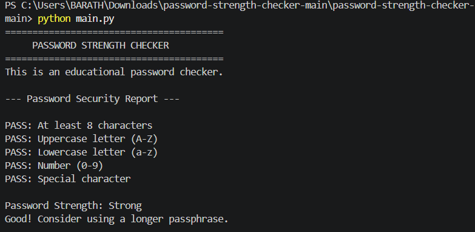

# Password Strength Checker 🔐

A beginner-friendly Python project that checks password strength based on length and different character types.

## Features

- Checks password length
- Checks for uppercase letters
- Checks for lowercase letters
- Checks for numbers
- Checks for special characters
- Gives a strength rating: Weak, Medium, or Strong
- Provides simple security feedback

## Technologies Used

- Python 3
- `string` module

## How to Run

Make sure Python 3 is installed on your computer.

Run the following command:

```bash
python main.py
```

The program will run the password strength checker and display a security report.

## Password Checks

| Check | Requirement |
|---|---|
| Length | At least 8 characters |
| Uppercase | A-Z |
| Lowercase | a-z |
| Number | 0-9 |
| Special Character | !, @, #, $, etc. |

## Example Output

```text
========================================
     PASSWORD STRENGTH CHECKER
========================================
This is an educational password checker.

--- Password Security Report ---

PASS: At least 8 characters
PASS: Uppercase letter (A-Z)
PASS: Lowercase letter (a-z)
PASS: Number (0-9)
PASS: Special character

Password Strength: Strong
Good! Consider using a longer passphrase.

Note: This is a basic educational checker.
It does not guarantee that a password is secure.
```

## Demo



## Project Structure

```text
password-strength-checker/
│
├── main.py
├── README.md
├── .gitignore
└── password-checker-demo.png
```

## Note

This is a basic educational password checker. Its rating does not guarantee that a password is completely secure.

For real-world security, passwords should be long, unique, and stored using secure password-hashing methods.

## Author

Ragu
